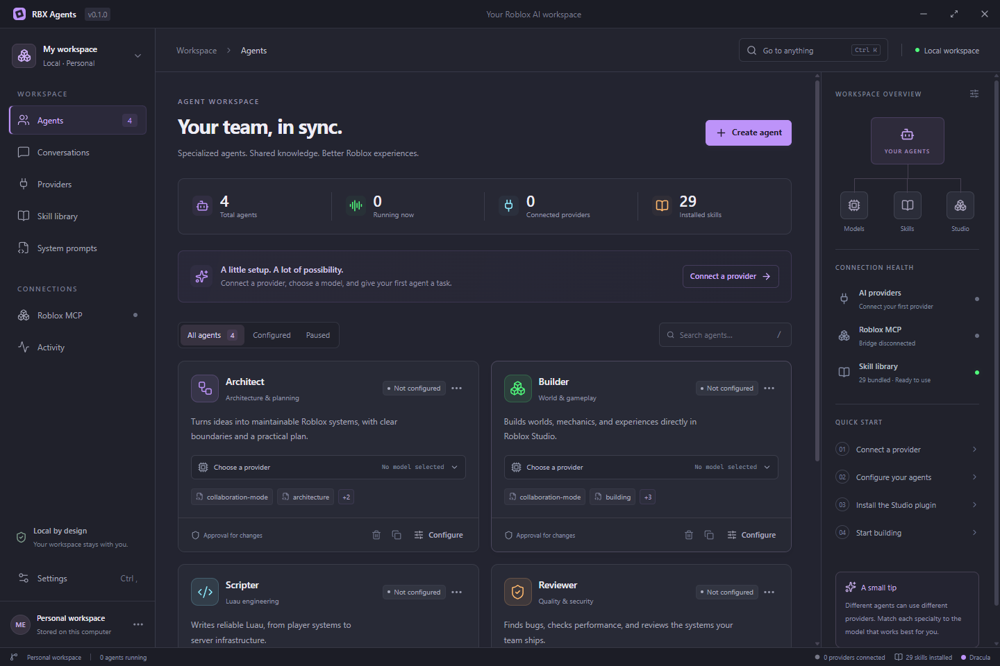

<div align="center">

# RBX Agents

**Your agents. Your models. Your Roblox workspace.**

A local-first desktop app for managing specialized AI agents that work with Roblox Studio.
Built with a clean Dracula-inspired interface, a complete Roblox skill library, and a bundled MCP bridge.


</div>



## What you can do

- **Build your team.** Create, duplicate, pause, and configure agents. Start with Architect, Builder, Scripter, and Reviewer.
- **Choose a model for each agent.** Connect OpenAI-compatible APIs, local inference servers, Anthropic, or an eligible ChatGPT account. Discover models or enter a model ID yourself.
- **Set their instructions.** Combine a workspace system prompt, individual agent instructions, and selected skills.
- **Use all 29 Roblox skills offline.** The complete [roblox-brain](https://github.com/tabooharmony/roblox-brain) library ships with the app, including every `references/full.md`. Import additional local skill collections.
- **Connect directly to Studio.** The [Chrrxs Roblox Studio MCP](https://github.com/Chrrxs/robloxstudio-mcp) server and matching plugin are bundled. Install the plugin from inside the app without a separate Node.js installation.
- **Keep control of changes.** Approve individual mutation calls, deny them, stop a run, or give an agent read-only access. Calls to the same MCP server are serialized across agents.
- **Keep your context.** Conversations, agent settings, token counts reported by providers, and recent activity are stored locally. Export agent definitions and the workspace prompt without credentials.

RBX Agents is a functional desktop preview. See [Current limitations](#current-limitations) for the verification and platform boundaries.

## Run from source

Requires **Node.js 24.18 or later**, npm, and Git. Installed desktop builds include their own runtime.

```bash
git clone https://github.com/MrHB102/RbxAgents.git
cd RbxAgents
npm ci
npm run dev
```

The `postinstall` step downloads the Electron runtime for your development machine.

To run the production build locally:

```bash
npm run build
npm run preview
```

## First launch

1. Open **Providers** and add a connection.
2. Select **Refresh models**, or use **Continue with ChatGPT** for a ChatGPT connection.
3. Open an agent’s **Configure** dialog and choose its provider and model.
4. Select its skills, instructions, permissions, and MCP connections.
5. Open **Roblox MCP**, select **Install Studio plugin**, then fully close and reopen Roblox Studio.
6. Connect the Studio plugin, select **Connect bridge**, and use **Check Studio instances** to inspect availability.
7. Start a conversation with an agent and give it a task.

A connected MCP bridge does not by itself mean that a Studio place is connected. Agents are instructed to discover the target Studio instance before making changes.

For a planning-only conversation, turn off the agent’s MCP connections in **Configure → Connections**. This allows the agent to work without Studio running.

## Providers and authentication

| Connection | Authentication | Inference API |
| --- | --- | --- |
| OpenAI-compatible | Your API key, or no key for a local server | Streaming Chat Completions with function tools |
| Anthropic | Your Anthropic API key | Streaming Messages API with tool use |
| ChatGPT | Browser authorization for RBX Agents | Public Responses API, using eligible ChatGPT plan usage |

Built-in endpoint presets include OpenAI, OpenRouter, Ollama, and LM Studio. A compatible provider must support streaming chat completions and function tools to use the full agent runtime. Local HTTP is accepted on loopback addresses; remote endpoints require HTTPS. Endpoints should include their API path, usually `/v1`.

### Continue with ChatGPT

The app implements the documented [Sign in with ChatGPT flow for local and open-source tools](https://developers.openai.com/siwc/token-sharing-open-source/sign-in):

- A browser authorization request identifies the app as **RBX Agents**.
- Each installation has a stable host ID; each connection retains its own issued client ID and verified account identity.
- PKCE, state, nonce, and signed ID-token verification protect sign-in.
- Credentials remain in the desktop main process. Refreshes are serialized and rotated tokens are saved together.
- Inference requires the granted `chatgpt.tokens.use.direct` permission, uses `store: false` and `stream: true`, and succeeds only after `response.completed`.
- **Manage usage** opens [ChatGPT Settings → Usage](https://chatgpt.com/settings/usage).

Availability depends on OpenAI’s current eligibility rules, account, plan, workspace, and permissions. Creating a connection does not grant model access. This integration does not read your ChatGPT conversation history. A paid or hosted distribution may require separate approval from OpenAI; consult the current official documentation before changing the distribution model.

### Claude and Claude Desktop

RBX Agents currently supports **Claude through the Anthropic API**. It does not offer a third-party Claude.ai subscription login or reuse Claude Desktop session tokens. Anthropic requires third-party applications to follow its [authentication and credential-use guidance](https://code.claude.com/docs/en/legal-and-compliance#authentication-and-credential-use). Native Claude Code integration is not implemented in this preview.

## Bundled Roblox skills

All four upstream collections are included. No network access is required to browse or load them after installation.

| Collection | Skills |
| --- | --- |
| **Core · 10** | `roblox-collaboration-mode`, `roblox-luau-core`, `roblox-luau-types`, `roblox-luau-patterns`, `roblox-architecture`, `roblox-networking`, `roblox-security`, `roblox-data`, `roblox-server-data`, `roblox-performance` |
| **Gameplay · 10** | `roblox-building`, `roblox-physics`, `roblox-npc-ai`, `roblox-camera`, `roblox-input`, `roblox-gui`, `roblox-animation-vfx`, `roblox-lighting`, `roblox-audio`, `roblox-localization` |
| **Design · 5** | `roblox-game-design`, `roblox-player-psychology`, `roblox-growth-design`, `roblox-analytics`, `roblox-monetization` |
| **Tools · 4** | `roblox-studio-mcp`, `roblox-tooling`, `roblox-cloud`, `roblox-publish-checklist` |

The upstream commit and license are preserved in [resources/roblox-brain](resources/roblox-brain). The runtime exposes a skill catalog and a `load_skill` tool so agents can read selected instructions and reference files on demand. The collaboration-mode entry point is also included automatically when selected.

To add a custom skill, choose **Skill library → Import skills**, then select a folder containing one or more `SKILL.md` files. The app copies the collection into its local data folder. Enable imported skills separately for each agent.

```text
my-skill/
├── SKILL.md
└── references/
    └── full.md
```

## Roblox MCP

The application pins **`@chrrxs/robloxstudio-mcp` 3.3.0**, including its matching `MCPPlugin.rbxmx`. The installer invokes the package’s own `--install-plugin` command using the bundled Electron Node runtime. It does not need to download or execute an unpinned npm package at launch.

The default Windows plugin location is detected by the upstream installer. A custom Plugins folder can be selected in **Roblox MCP → settings**. After installation or replacement, restart Studio completely. The upstream installer may replace its existing plugin or remove the other edition to maintain version compatibility.

### Linux and Wine

RBX Agents runs natively on Linux. Roblox Studio itself requires a compatible Wine setup. Before installing the plugin, select the Studio **Plugins** directory inside your Wine prefix. Where needed, configure the upstream bridge environment using `ROBLOX_STUDIO_WINE_LAUNCHER`, `ROBLOX_STUDIO_EXE`, and related non-secret settings. See the [upstream Linux configuration](https://github.com/Chrrxs/robloxstudio-mcp/blob/main/docs/configuration.md#native-linux-with-wine).

Custom MCP servers support **stdio**, **Streamable HTTP**, and **legacy SSE**. HTTP/SSE connections can store a bearer token in the credential vault. Local server commands run as your OS user; configure executables you trust. The environment editor is for non-secret values and is stored in plain text with the workspace.

## Desktop builds

Build artifacts are written to `release/`. Build on the target OS, or use the included GitHub Actions build matrix. This repository does not automatically publish releases.

```bash
# Windows NSIS installer with x64 and ARM64 payloads
npm run dist:win

# Linux AppImage and Debian packages: x64 and ARM64
npm run dist:linux

# Build only the current host target
npm run dist
```

| Platform | Architecture | Build track |
| --- | --- | --- |
| Windows 10/11 | x64, ARM64 | Current Electron 45 |
| Linux | x64, ARM64 | Current Electron 45 |
| Windows 10, 32-bit | x86 / ia32 | Optional legacy Electron 43 |
| Linux, 32-bit ARM | ARMv7 | Optional legacy Electron 43; tarball |
| Linux, 32-bit Intel; other CPU families | ia32, RISC-V, others | Not supported by these Electron builds |

```bash
# Optional legacy targets
npm run dist:legacy:win
npm run dist:legacy:linux
```

“All architectures” is not a platform guarantee: Electron does not supply binaries for every CPU and OS combination. [Electron 44 removed Windows x86 and Linux ARMv7](https://www.electronjs.org/blog/electron-44-0). The legacy commands pin 43.8.3, whose support ends in January 2027; these are separate compatibility builds, not a long-term security track. Windows 11 does not have a 32-bit x86 edition. Linux compatibility also depends on the distribution’s system libraries.

Local verification is performed on Windows x64. Linux, ARM64, and legacy packages need builds and runtime checks on their target systems before distribution. Code signing is not configured; locally generated installers are unsigned.

## Development and checks

```bash
npm run typecheck
npm test
npm run verify:skills
npm run test:e2e
npm run test:package # After creating a Windows x64 package
npm run build
npm audit
```

The desktop end-to-end test starts an isolated Electron profile and a local test API. It exercises the visible UI, provider discovery, streamed agent output, skill loading, persistence after restart, and actual plugin installation into a temporary folder. The package smoke test checks the compiled executable, bundled resources, and plugin installer with another isolated profile. These tests do not require paid API credentials or modify the developer’s Studio plugin folder. On a headless Linux host, run desktop tests through a suitable virtual display such as Xvfb.

## Storage and privacy

Data is saved under Electron’s per-user application data directory, typically `%APPDATA%/rbx-agents` on Windows and `$XDG_CONFIG_HOME/rbx-agents` or `~/.config/rbx-agents` on Linux.

- `workspace.json`: settings, agent definitions, provider metadata, conversations, skills, MCP configuration, and the latest 500 activity events.
- `credentials.enc`: encrypted API keys, HTTP MCP bearer tokens, and ChatGPT credentials, when secure OS storage is available.
- `skills/`: imported local skill collections.

On Windows, credential encryption uses the OS-backed Electron `safeStorage` implementation. On Linux, the app requires an available secure keyring and rejects the `basic_text` fallback. Without a secure keyring, credentials remain in memory for the current session only. Conversations and configuration are not encrypted at rest.

The renderer has no Node.js access. A narrow preload bridge validates actions in the main process. Credentials are excluded from state snapshots and exports. Provider requests are sent from the main process, and known credentials are redacted from error/activity output. No analytics or telemetry service is configured.

Messages, selected skill content, and MCP tool results are sent to the provider selected for the conversation. Local storage does not make a remote provider’s inference private to your device.

## Architecture

```text
src/
├── main/       Electron lifecycle, validated IPC, storage, OAuth, providers,
│               skill loader, MCP processes, and agent runtime
├── preload/    Narrow typed renderer bridge
├── renderer/   React desktop interface and Dracula-inspired CSS
└── shared/     Domain types, starter agents, and default instructions
resources/     Complete bundled Roblox skill library and attribution
tests/         Unit tests and Electron desktop integration tests
```

Independent agent conversations can run concurrently. Each uses a snapshot of its agent configuration at start. The runtime supports bounded model/tool loops, per-call approvals, cancellation, and explicit failures on incomplete provider streams. Studio calls to the same MCP server are queued to prevent interleaved actions.

## Current limitations

- Live ChatGPT OAuth, live Anthropic inference, and real Studio place edits require the user’s account and Studio connection; fixture tests do not establish those external services’ availability.
- This preview has text-based agent conversations. Image attachments and multimodal screenshot feedback are not implemented.
- Agents are managed individually; automatic agent-to-agent delegation and shared task orchestration are not implemented.
- The project folder setting labels your workspace. Direct project filesystem tools, terminal access, and Rojo synchronization are not implemented; Studio access goes through MCP.
- MCP OAuth discovery, automatic skill updates, configuration import, automatic application updates, signed releases, and native Claude Code integration are not implemented.
- The app serializes its own Studio calls. It cannot coordinate external MCP clients or manual Studio edits made at the same time.

## Credits and license

- [TabooHarmony/roblox-brain](https://github.com/tabooharmony/roblox-brain): all 29 skills and complete references, MIT; bundled license preserved.
- [Chrrxs/robloxstudio-mcp](https://github.com/Chrrxs/robloxstudio-mcp): Studio MCP server and plugin, MIT; upstream package license preserved.
- [Dracula](https://draculatheme.com/): palette inspiration.
- Electron, React, Lucide, the Model Context Protocol TypeScript SDK, Zod, YAML, and jose.

RBX Agents is an independent project and is not affiliated with or endorsed by Roblox, OpenAI, Anthropic, or the Dracula project.

Released under the [MIT License](LICENSE).
